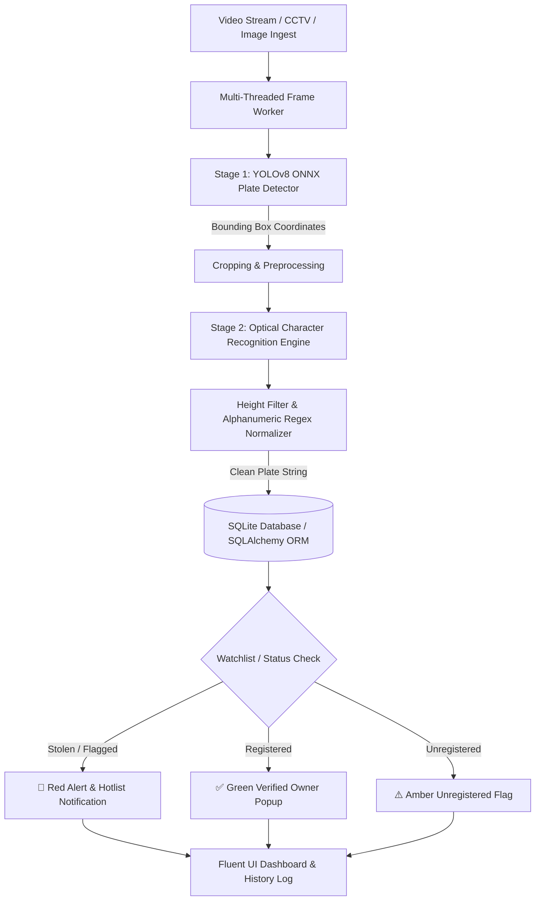

<div align="center">

# 🚗 Automatic Number Plate Detection & Surveillance System (ANPR)

<p align="center">
  <strong>An enterprise-grade, high-performance Computer Vision system for real-time license plate detection, OCR extraction, stolen vehicle alerting, and fleet intelligence.</strong>
</p>

[](https://github.com/hammad-44/Number-Plate-Detection-System/releases)
[](https://www.python.org/)
[](https://ultralytics.com)
[](https://pytorch.org/)
[-41CD52?style=for-the-badge&logo=qt&logoColor=white)](https://github.com/zhiyiYo/PyQt-Fluent-Widgets)
[](https://github.com/hammad-44/Number-Plate-Detection-System/releases)
[](LICENSE)

<br/>

[📥 Download Portable Windows App (.exe)](https://github.com/hammad-44/Number-Plate-Detection-System/releases) • [⚡ Key Features](#-key-features) • [🏛️ System Architecture](#️-system-architecture) • [🚀 Quick Start](#-quick-start) • [📊 Tech Stack](#-tech-stack)

</div>

---

## 📌 Executive Summary

The **Automatic Number Plate Detection System (NPDS)** is an end-to-end intelligent transportation and surveillance solution. Built with a two-stage deep learning pipeline (YOLOv8 ONNX detector + localized character OCR), it extracts, normalizes, and matches vehicle registration plates against law enforcement watchlists and internal vehicle registries in real-time.

Packaged within a modern **Windows 11 Fluent Design** desktop interface, the system supports live multi-threaded CCTV / IP camera streams, batch media scanning, automated stolen-vehicle alerts, and relational database analytics.

---

## 🎬 Application Preview

> *Tip for Evaluators: You can record a quick GIF using Windows Game Bar (`Win + Alt + R`) or view the bundled test cars in `assets/Cars/`.*

```
+---------------------------------------------------------------------------------------+
|  NPDS - Intelligent Traffic Surveillance & Plate Recognition                         |
+-------------------+-------------------------------------------------------------------+
|  [🏠] Dashboard   |  📹 Live Stream Feed                    [Plate Detected: LEF 2640] |
|  [📹] Live Feed   |  +------------------------------------+  Status: REGISTERED       |
|  [📷] Media Scan  |  |  [Bounding Box: Conf 94.2%]        |  Owner: Hammad Haider     |
|  [📁] Records     |  |       [ LEF-2640 ]                 |  Make: Honda Civic        |
|  [📊] Analytics   |  +------------------------------------+  Color: White             |
|  [🔍] Watchlist   |  Real-Time Tracking: 32.4 FPS          Alert: None (Authorized)   |
|  [🚗] Vehicle DB  |  Recent Scans: 142 Today               Processing Latency: ~31ms  |
+-------------------+-------------------------------------------------------------------+
```

---

## ✨ Key Features

- **⚡ High-Throughput Real-Time Inference (30+ FPS)**
  - Runs optimized **ONNX Runtime** inference with CUDA acceleration and seamless CPU fallback.
  - Multi-threaded video ingest worker prevents UI freeze during high-resolution frame processing.
- **🔍 Two-Stage Plate Localization & OCR**
  - **Stage 1 (Detector):** High-precision YOLO bounding-box detection isolating the plate region under challenging lighting, angles, and distances.
  - **Stage 2 (OCR & Regularization):** Height-filtered alphanumeric extraction removing noise (e.g., province names, manufacturing years), formatted through strict regex normalizers.
- **🚨 Watchlist & Stolen Vehicle Hotlist Alerting**
  - Instant visual indicators and alerts triggered when a detected plate matches stolen or flagged database records.
- **📁 Batch Media Scanning**
  - Process standalone car images or full recorded video footage with confidence thresholds and exportable results.
- **💾 Relational Database Integration (SQLite / SQLAlchemy)**
  - Full CRUD operations for registered vehicles, owner details, chassis/engine numbers, and historical scan logs with timestamps.
- **🎨 Windows 11 Fluent UI (QFluentWidgets)**
  - Sleek modern aesthetics featuring dark and light theme toggles, fluid transitions, glassmorphism cards, and responsive navigation.

---

## 🏛️ System Architecture



---

## 📊 Tech Stack & Benchmarks

| Component | Technology | Rationale |
| :--- | :--- | :--- |
| **Object Detection** | YOLOv8 (ONNX format) | Real-time object localization at ~30ms inference time |
| **OCR Engine** | EasyOCR + Custom Filters | Robust text recognition on varying plate fonts and scales |
| **Runtime Acceleration** | ONNX Runtime (`onnxruntime-gpu` / `onnxruntime`) | Cross-hardware deployment with CUDA/CPU fallback |
| **Desktop Framework** | PyQt5 + PyQt-Fluent-Widgets | Modern Windows 11 design language and hardware-accelerated rendering |
| **Database & ORM** | SQLite + SQLAlchemy | Lightweight, zero-config relational storage for offline deployments |
| **Image Processing** | OpenCV (`cv2`) & NumPy | Matrix operations, frame cropping, and color-space conversions |

---

## 🚀 Quick Start

### Option A: Portable Windows Executable (No Python Required)
For recruiters, reviewers, and evaluators:
1. Go to the [Releases Page](https://github.com/hammad-44/Number-Plate-Detection-System/releases).
2. Download `Number-Plate-Detection-System-v1.0.0-win64.zip`.
3. Extract the folder and double-click **`NumberPlateDetectionSystem.exe`**.
4. Test with sample car images located in the included `assets/Cars/` folder!

---

### Option B: Run from Source (Development Setup)

#### 1. Clone the repository
```bash
git clone https://github.com/hammad-44/Number-Plate-Detection-System.git
cd "Number Plate Detection System"
```

#### 2. Create and activate a virtual environment
```powershell
python -m venv venv
.\venv\Scripts\activate
```

#### 3. Install dependencies
```powershell
pip install -r requirements.txt
```

#### 4. Launch the application
```powershell
python main.py
```

---

## 📦 How to Build the Standalone Executable (.exe)

This repository includes an automated build pipeline that compiles the full application, bundles model weights, SQLite data, and assets into a portable release package:

```powershell
# In your activated virtual environment:
python package_release.py
```

The script will automatically compile via PyInstaller and generate:
- **`dist/NumberPlateDetectionSystem/`** (Self-contained application folder)
- **`dist/Number-Plate-Detection-System-v1.0.0-win64.zip`** (Ready for GitHub Releases)

---

## 📂 Project Structure

```
Number-Plate-Detection-System/
├── assets/                  # Sample vehicle images and icons for testing
│   └── Cars/                # 50+ real-world vehicle images with license plates
├── core/                    # Core AI & Video Processing Pipeline
│   ├── detector.py          # YOLOv8 ONNX plate detector with NMS
│   ├── ocr.py               # OCR engine with height filtering & regex
│   ├── signals.py           # PyQt inter-thread signals
│   └── video_thread.py      # Background camera ingestion worker
├── database/                # Relational Database Models & Manager
│   └── db_manager.py        # SQLAlchemy models (Plates, Vehicles, Watchlist, Logs)
├── models/                  # Neural network weights
│   └── best.onnx            # Fine-tuned license plate detection model
├── ui/                      # PyQt5 Fluent Interface Pages
│   ├── main_window.py       # FluentWindow navigation container
│   └── pages/               # Individual functional views
│       ├── dashboard.py     # System statistics and recent scans
│       ├── live_feed.py     # Real-time camera feed & plate tracker
│       ├── media_scan.py    # Batch photo/video inspector
│       ├── records.py       # Historical detection logs
│       ├── watchlist.py     # Stolen & wanted vehicle hotlist
│       ├── vehicles.py      # Vehicle database CRUD
│       └── analytics.py     # Chart summaries and metrics
├── npds.spec                # PyInstaller specification file
├── package_release.py       # One-click release bundler script
├── requirements.txt         # Python package dependencies
├── main.py                  # Application entry point
└── README.md                # Project documentation
```

---

## 👨‍💻 Author & Contact

**Hammad Haider**
- GitHub: [@hammad-44](https://github.com/hammad-44)
- Repository: [Number-Plate-Detection-System](https://github.com/hammad-44/Number-Plate-Detection-System)

*If this project was helpful in your evaluation or research, feel free to star ⭐ the repository!*
